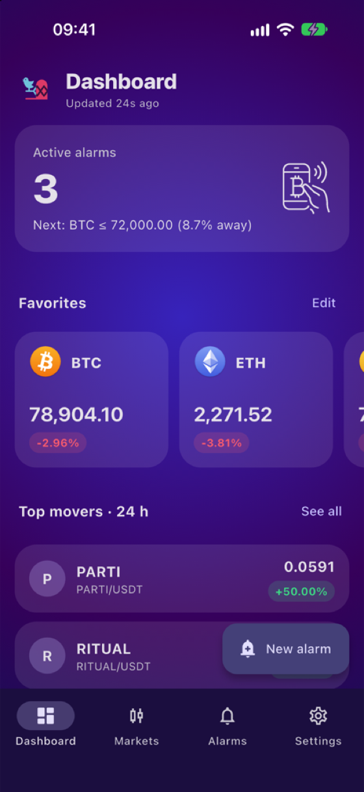
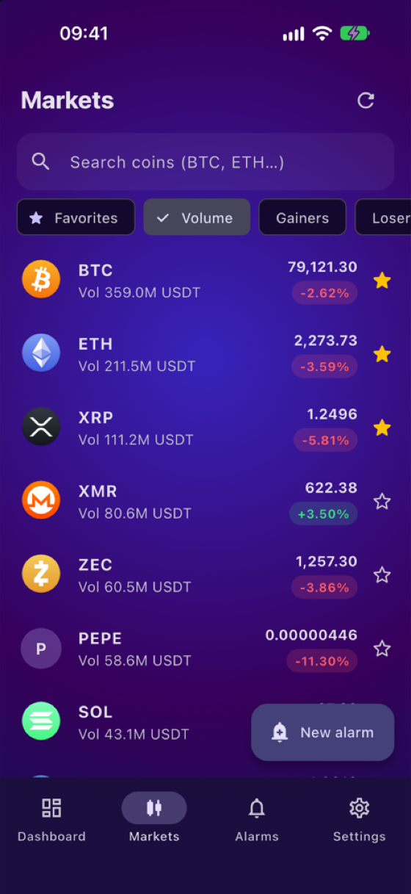
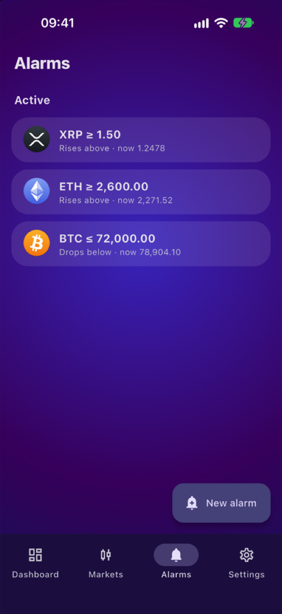
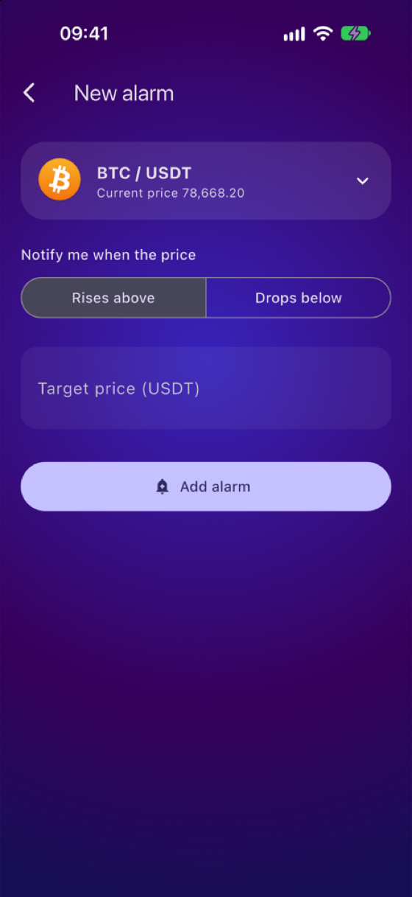
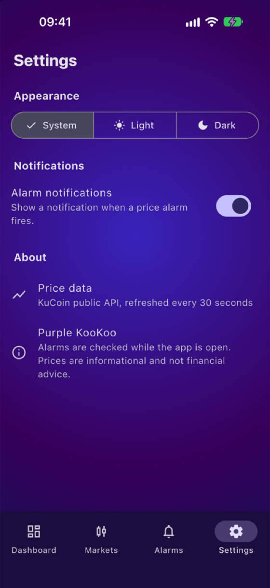

<h1 align="center">Purple KooKoo</h1>

<p align="center">
  <b>Crypto price alarms with live market data.</b><br>
  One Flutter codebase for iOS, Android and the web.
</p>

<p align="center">
  
  
  
  
</p>

<p align="center">
  
  
  
  
  
</p>

## Features

| | |
|---|---|
| **Live market data** | Prices and 24 h change for 800+ USDT pairs from the public KuCoin API. Refreshes every 30 s, pauses in the background, supports pull-to-refresh, and degrades gracefully offline (last prices stay visible with a retry banner). |
| **Price alarms** | Notify me when a coin *rises above* or *drops below* a target. Validated against the current price, persisted on-device, swipe to delete (with undo), re-arm after firing. |
| **Local notifications** | A system notification (and an in-app banner) when an alarm fires. Permission is requested in context, not at launch, and can be switched off in Settings. |
| **Markets explorer** | Search, sort (volume, gainers, losers, A–Z), favorites filter, and one tap from any coin to a pre-filled alarm. |
| **Favorites & dashboard** | Star coins to pin them to the dashboard, with the nearest active alarm and top 24 h movers at a glance. |
| **Light, dark & system theme** | Material 3 theme built around the original purple identity; choice is remembered. |

Also: responsive layout capped for tablets and web, safe-area aware, semantic labels on icon buttons, and number formatting that adapts to price magnitude (`78,859.60`, `0.00000446`).

## Getting started

```bash
cd pruple_kookoo
flutter pub get
flutter run                 # pick a device, or: flutter run -d chrome
```

Requires Flutter 3.47+ (Dart 3.7+). For iOS you also need Xcode and CocoaPods; for Android, the Android SDK with command-line tools.

```bash
flutter test                # 24 unit and widget tests
flutter analyze             # static analysis (clean)
flutter build apk           # Android
flutter build ios --no-codesign
flutter build web
```

## Architecture

```
lib/
├── main.dart               app entry, lifecycle (pauses polling in background)
├── app_services.dart       wires controllers together; InheritedWidget scope
├── core/                   theme, formatting helpers, coin icon registry
├── data/                   Ticker + Alarm models, KuCoin MarketRepository
├── state/                  MarketController, AlarmController, SettingsController
├── services/               AlarmNotifier (flutter_local_notifications)
├── screens/                dashboard, markets, alarms, alarm form, settings
└── widgets/                shared UI (glass card, coin icon, change chip…)
```

- **State** uses plain `ChangeNotifier` + `ListenableBuilder`. No state-management dependency.
- **Data flow:** `MarketController.refresh()` → `onData` → `AlarmController.evaluate()` → notification + in-app banner.
- **Testability:** the HTTP client, repository, notifier and `SharedPreferences` are all injectable; tests use fakes and `MockClient`.
- **Persistence:** alarms, favorites and settings via `shared_preferences`, tolerant of corrupt data.

## Disclaimer

Prices are informational and provided by a third-party public API. This app is not financial advice.
